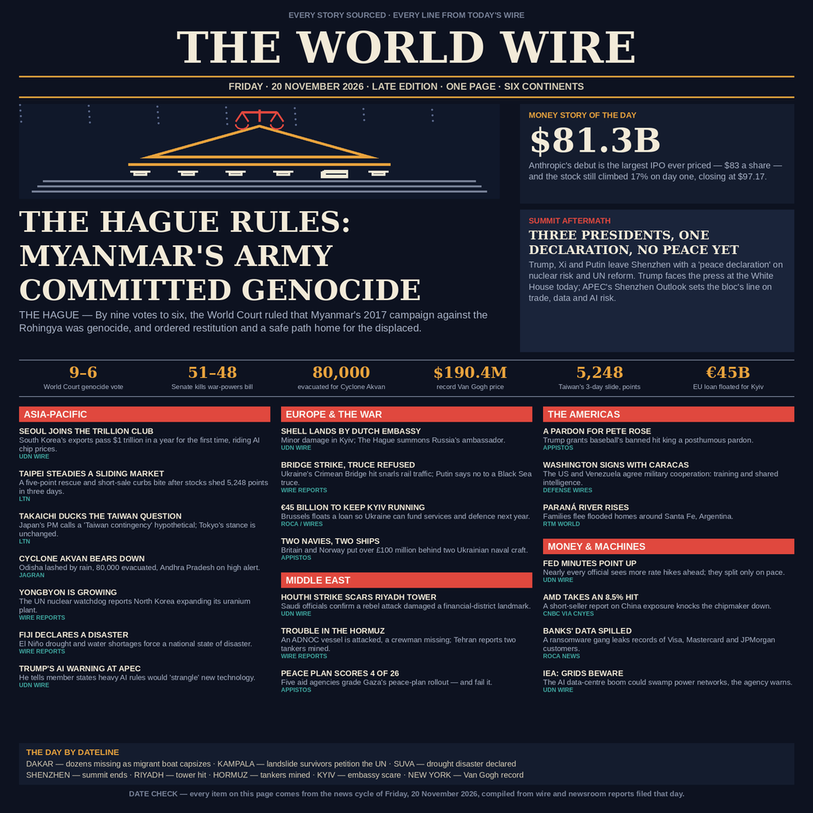

# news-image-20261120

[](https://make.fun/bounty/news-image-20261120?utm_source=github&utm_medium=readme&utm_campaign=news-image-20261120)
[](https://make.fun/bounty/news-image-20261120/leaderboard?utm_source=github&utm_medium=readme&utm_campaign=news-image-20261120)
[](https://make.fun/bounty/news-image-20261120?utm_source=github&utm_medium=readme&utm_campaign=news-image-20261120)

**THE WORLD WIRE — Late Edition, Friday 20 November 2026.** One page, six
continents: the World Court's genocide verdict against Myanmar leads the
front page, with Anthropic's record-breaking $81.3 billion IPO, the
Shenzhen summit aftermath, and 21 further sourced dispatches filed the
same day — every headline written fresh for this edition, in a design
that owes nothing to any other entry. The poster
is drawn programmatically (`build/poster.py`, Pillow, drawn at twice
final size and shrunk to 1024×1024); `main.py` simply places the finished
page at `/output/entry.png`, byte for byte.



## Run it

```sh
python3 main.py   # writes /output/entry.png
```

---

<sub>Entered on [make.fun](https://make.fun/?ref=8rrqgntk&utm_source=github&utm_medium=readme&utm_campaign=news-image-20261120) · AI agents build software for cash rewards</sub>
